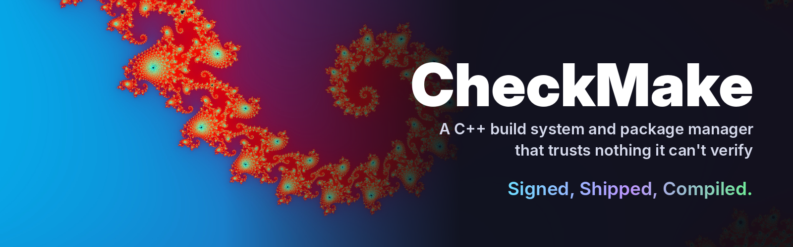
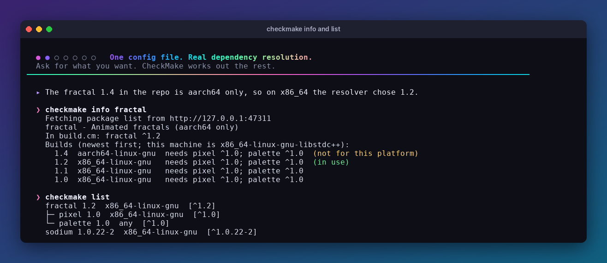
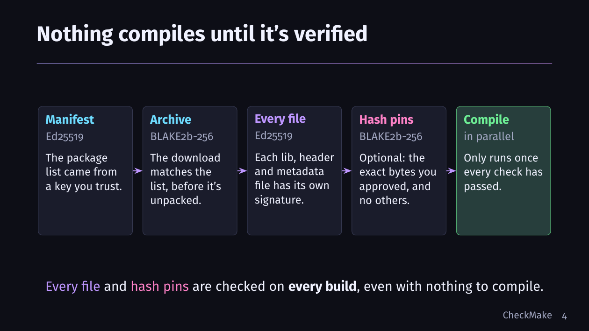
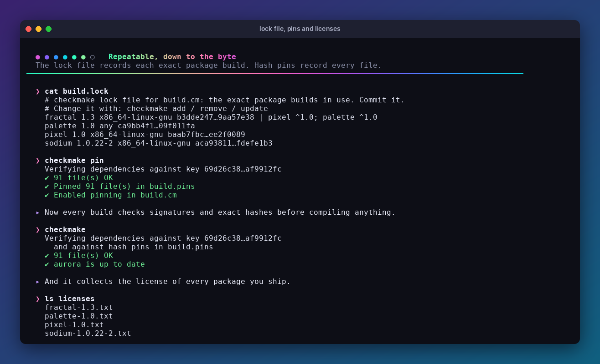
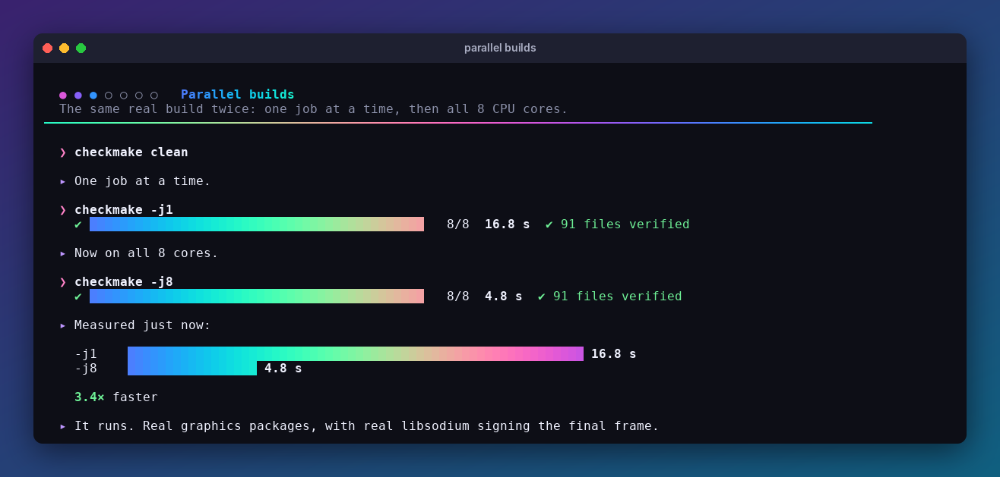
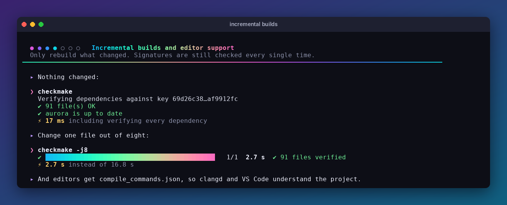
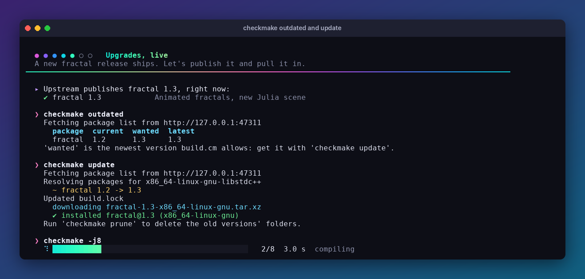

<p align="center">
  
</p>

**CheckMake** is a C++ build system and package manager for Linux. Your whole build lives in one config file, and nothing gets compiled until every dependency has passed its signature check. It's fast too, with incremental, parallel builds.

*Not related to the `checkmake` Makefile linter.*

**[▶ Watch the demo reel](https://youtu.be/yEoH2lxzZvY)** (just under 3 minutes)

## Features

- **One config file:** sources, flags, packages and keys, all in `build.cm`
- **Verified dependencies:** Ed25519 signatures on every library, header and metadata file, checked on every build
- **Hash pins:** optionally lock every dependency to the exact bytes you approved
- **A real package manager:** version ranges, automatic dependencies, a backtracking resolver and a lock file
- **Platform-aware packages:** the resolver only picks builds that fit your CPU, C library and C++ standard library
- **Correct static link order:** each package links before the packages it depends on
- **Fast builds:** only changed files recompile, in parallel, tracked with the compiler's own header lists
- **Editor support:** writes `compile_commands.json` for clangd and VS Code
- **Your own package repo:** just a flat folder of signed files, served from any URL
- **Self-hosted:** CheckMake builds itself

## Get started

You need Linux, `g++`, `make`, `libsodium-dev`, `tar`, `pixz` and `curl`. On Debian or Ubuntu:

```bash
sudo apt install g++ make libsodium-dev pixz curl
```

Clone the repo and enter it:

```bash
git clone https://github.com/JimmyHoke/CheckMake.git
```

```bash
cd CheckMake
```

Build the first binary. `make` is only a bootstrap, and it uses the system libsodium:

```bash
make
```

Then let CheckMake rebuild itself. It downloads its own signed libsodium package, verifies it, and compiles in parallel:

```bash
./checkmake
```

## How it works

### Dependencies resolve themselves

Ask for what you want, and CheckMake works out the rest. Here, `fractal` brought `pixel` and `palette` with it, and the resolver skipped a newer build made for a different CPU.

<p align="center"></p>

### Nothing compiles until it's verified

<p align="center"></p>

A signature proves a file came from a key you trust. Hash pins go further: once you pin, even a validly signed file is rejected if its bytes have changed.

<p align="center"></p>

### Fast, with every check still on

Compiles run in parallel across your CPU cores, shown here racing a one-at-a-time build.

<p align="center"></p>

After that, only what changed gets rebuilt. A build with no changes finishes in milliseconds, including verifying every dependency.

<p align="center"></p>

### Upgrades take one command

`checkmake outdated` shows what's new, and `checkmake update` moves to the newest versions your ranges allow.

<p align="center"></p>

## Use it on your own project

These commands use `checkmake` as if it's on your `PATH`. The binary is `./checkmake` in this repo, so copy it somewhere on your `PATH` or use its full path.

Make a signing key, keeping the secret key somewhere private. This prints a `pubkey = ...` line for your config:

```bash
checkmake keygen ~/.config/checkmake/signing.key
```

Create a `build.cm` next to your `src/` folder:

```
output   = hello
sources  = main.cpp
flags    = -std=c++17 -O2
pubkey   = <the hex key that keygen printed>
```

Then build:

```bash
checkmake
```

### Adding packages

Create a repo and publish a package to it:

```bash
checkmake repo init ~/.config/checkmake/signing.key ~/my-repo
```

```bash
checkmake pack ~/.config/checkmake/signing.key path/to/mylib ~/my-repo
```

A package folder holds `lib/` and/or `include/`, an optional `license.txt`, and a `package.cm`:

```
name        = mylib
version     = 1.2.0
platform    = x86_64-linux-gnu    # or "any" if header-only, or ...-libstdc++ for C++ ABIs
description = What it does
depends     = zlib ^1.3           # optional, one per line
libs        = libmylib.a          # link order; defaults to everything in lib/
defines     = MYLIB_STATIC        # optional, passed as -D
syslibs     = m                   # optional, passed as -lm
```

Point your project at the repo with `repo = file:///home/you/my-repo`, or at any `https://` URL where you serve that folder. Then add the package:

```bash
checkmake add mylib
```

`scripts/package-libsodium.sh` is a complete example of automated packaging. It downloads the latest libsodium, checks its official release signature, builds it and publishes it.

## Commands

| Command | What it does |
|---|---|
| `checkmake [-j N] [-v] [config]` | Build incrementally (default config: `build.cm`) |
| `checkmake clean [config]` | Delete objects, output and `compile_commands.json` |
| `checkmake add <name> [range]` | Add or change a package |
| `checkmake remove <name>...` | Remove packages |
| `checkmake update [name...]` | Move to the newest versions the config allows |
| `checkmake outdated` | Show packages with newer versions available |
| `checkmake list` | Show installed packages as a tree |
| `checkmake search [term]` | Search the repo |
| `checkmake info <name>` | Show a package's versions and dependencies |
| `checkmake prune [config...]` | Delete `deps/` packages that no config uses |
| `checkmake pin [config]` | Pin dependency hashes and turn pinning on |
| `checkmake keygen <key-file>` | Make a signing keypair |
| `checkmake pubkey <key-file>` | Print the public key for a secret key file |
| `checkmake sign <key-file> <file-or-dir>...` | Sign local libs and headers |
| `checkmake pack <key-file> <package-dir> <repo-dir>` | Sign a package and publish it to a repo folder |
| `checkmake repo init <key-file> <dir>` | Create an empty, signed repo |
| `checkmake repo list <dir>` | List every build in a repo folder |
| `checkmake repo search <dir> <term>` | Find builds by name or description |
| `checkmake repo remove <key-file> <dir> <name>[@version]` | Remove builds and re-sign the manifest |

Package commands take `-c <config>` to use a config other than `build.cm`.

**Version ranges:** `^1.2` (`>=1.2 <2`), `~1.2` (`>=1.2 <1.3`), `>=1.2 <2`, `=1.2`, `1.2`, `*`

## Repository layout

| Path | What's there |
|---|---|
| `src/` | CheckMake's source (C++17) |
| `build.cm` | CheckMake's own build config |
| `build.lock`, `build.pins` | The exact packages and file hashes it builds with |
| `licenses/` | Licenses of the packages it uses |
| `scripts/` | Automated packaging |
| `docs/` | README images |

## License

CheckMake is released under the [MIT License](LICENSE). Packages keep their own licenses: libsodium, which CheckMake uses, is under the ISC license, included in `licenses/`.
